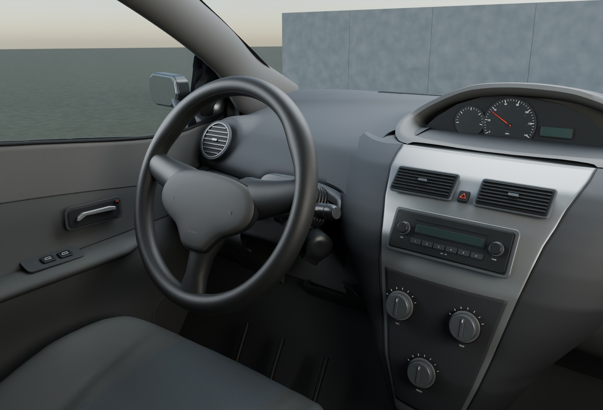

# 驾驶舱静态模型



[同机位改模前后](driver-comparison.jpg) · [驾驶位原图](driver.jpg) · [从副驾驶看方向盘](passenger.jpg) · [全舱](overview.jpg) · [方向盘近景](wheel.jpg) · [中控近景](controls.jpg)

## 打开或重建

本次云端工作区中的场景保存在 `work/cabin-model/ep02-cabin.blend`。可在 Blender 中单独选择仪表、面板、拨杆、门内饰和灯光，五台检查相机已经保存。F12 使用 Cycles 渲染当前相机。

在新检出的仓库根目录运行下列命令，即可下载并校验官方原包、提取几何、重建场景并生成五张照片式静帧。使用 Python 3.11 或更新版、NumPy、curl、unzip 和 Blender 4.5 LTS。设置 `BLENDER_BIN` 可指定本机 Blender。仅重建模型可在命令后加 `--views`。

```bash
bash scripts/build_ep02_cabin.sh --width 1500 --samples 40
```

## 几何和饰件

| 部分 | 依据与处理 |
| --- | --- |
| 车体比例、玻璃、仪表台外形、座椅和相对安装位置 | CCSA 精细版 v2j，2016 年 10 月发布。原包为 940 个零件、1,488,581 个节点。场景读取 474 个相关壳零件，保留来源零件编号，部分骨架在展示视图中隐藏。 |
| 轮缘、喇叭盖、转向柱和拨杆 | 根据官方轮缘外径、倾角和原盖位置重建外覆材料与分件线。转向盘不带品牌标识。 |
| 仪表、中控、出风口和空调 | 表盘印刷、指针、立体风口叶片、收音机、旋钮及警示灯开关均为自建饰件。表针读取 56 km/h 求解历程的初速度并换算到 mph 刻度。音响和行程屏保持未点亮状态。 |
| 门、脚舱和顶棚 | 门板表皮沿原件轮廓放样，补建扶手、门把手、扬声器网格、脚舱地毯、踏板、手动挡杆、遮阳板及内外后视镜。塑料纹、座椅织物、金属反射和玻璃边缘为程序材质。 |
| 画面 | 驾驶位对照沿用旧基准的眼点、19 mm 镜头和离墙 8 m 的构图。驾驶位为 1080×1920，另四张宽 1500 像素。五张静帧均来自同一可编辑场景。 |

两个有限元版本对应同一辆四门手动挡轿车。旧粗网格上仪表台有 2,760 个壳单元，精细版有 10,197 个。原方向盘为 770 和 2,756 个。两种网格都包含承力支架，因此建模时另外处理了可见表皮。饰件的轮廓、字样和表面颜色属于可编辑的近似重建，尚缺这辆样车的整舱纹理扫描。可见结构的布置还参照了 IIHS 同代美规四门车实拍。[CCSA 模型页](https://www.ccsa.gmu.edu/models/2010-toyota-yaris/) · [IIHS 车辆照片](https://www.iihs.org/ratings/vehicle/toyota/yaris-4-door-sedan/2010)

当前模型处于未变形状态。原 v1l 碰撞数据单独保留，高精度饰件还未绑定到碰撞历程。原包及含车型网格的 Blender 场景保存在忽略版本控制的工作目录。感谢乔治梅森大学 CCSA 和 FHWA。[CCSA v2j 官方原包](https://media.ccsa.gmu.edu/model/2010-toyota-yaris-detailed-v2j.zip)
