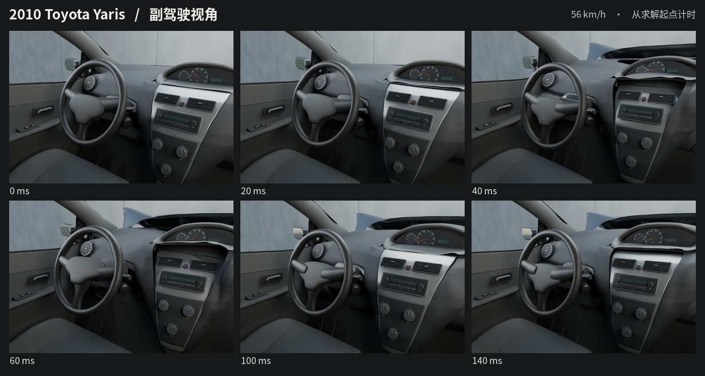
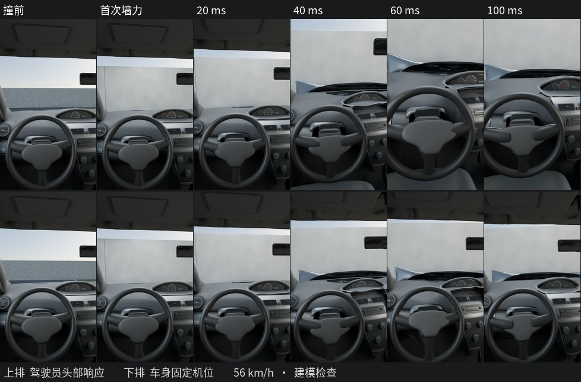

# 56 km/h 驾驶舱变形检查

## 单文件查看六个姿态

在云工作区打开 `work/cabin-motion/ep02-cabin-six-poses.blend`（80.5 MB，Blender 4.5 LTS）。按左右方向键切换第 1–6 帧，依次对应求解起点后约 0、20、40、60、100、140 ms。默认从副驾驶侧看向方向盘，也可切换五个机位、旋转视角或编辑饰件。六个姿态都保存在文件内，可单独复制打开。



独立重开单文件和完整工程，逐帧比较了全部 486 个变形网格，每个时刻约 81.7 万个顶点。最大局部坐标差为 0.000043 mm 以内，968 个场景对象的世界变换逐项一致，外部文件依赖为零。[逐帧记录](56kmh-portable-check.json)

在仓库根目录运行下列命令可从完整时间轴重建单文件，然后逐帧复核。

```bash
work/blender-4.5.16-linux-x64/blender -b work/cabin-motion/timeline/ep02-cabin-motion.blend -t 4 --python-exit-code 1 -P scripts/ep02_cabin_portable.py -- work/cabin-motion/ep02-cabin-six-poses.blend
work/blender-4.5.16-linux-x64/blender -b -t 4 --python-exit-code 1 -P scripts/ep02_cabin_portable_check.py -- work/cabin-motion/timeline/ep02-cabin-motion.blend work/cabin-motion/ep02-cabin-six-poses.blend work/cabin-motion/portable-check.json
```

## 驾驶员视角与固定机位



[撞前](approach.jpg) · [首次墙力](contact.jpg) · [20 ms](20ms.jpg) · [40 ms](40ms.jpg) · [60 ms](60ms.jpg) · [100 ms](100ms.jpg)

六组画面的左图使用头部响应，右图固定在驾驶座横梁。每组使用同一份变形几何。撞前图取自求解起点前 0.45 s 的等速接近，其余时间从首次测到正面壁障反力起算。未加界面。头部机位在 40–100 ms 向前、向下，顶部暗区缩小，成片的界面位置还需在最终脉冲下单独检查。

**这些图用于检查建模。** 56 km/h 粗网格总能量最大漂移 6.42%，超过 5% 验收线。坐标来自求解输出，精细内饰的运动由对应粗网格传递。饰件之间没有另算接触和断裂。两张图中的相机差异来自摄影模型。[能量复核](../../physics/56kmh-energy-audit.json) · [相机角速度](56kmh-camera-angular-speed.png) · [相机朝向](56kmh-camera-orientation.csv)

## 在 Blender 查看完整时程

云工作区的 `work/cabin-motion/timeline/ep02-cabin-motion.blend` 有 **281 帧**，约每 0.5 ms 一个原生求解样本，覆盖 0–140 ms。拖动时间轴可查看各时刻，默认从副驾驶位置看向方向盘。五台相机均已保留。时间轴第 1 帧是求解起点，第 121 帧约为 60.00 ms。工程内的 `Solver sample times.csv` 保存每帧的精确仿真时间和质心合速度。下载完整工程时将同目录的 `cache/` 一起保留。

工作区内已打包完整工程和全部点缓存，文件为 `work/cabin-motion/ep02-cabin-motion.zip`（2.45 GB）。解压后打开 `timeline/ep02-cabin-motion.blend`。两个工程包含原车几何，按项目约定保存在工作区。

重建需要前一步的 v1l 节点缓存、粗网格零件表、速度历程和 v2j 静态驾驶舱工程。以下命令在仓库根目录执行。最后一个参数是新的输出目录，用于保留已有的工程。

```bash
bash scripts/build_ep02_cabin.sh --views
work/blender-4.5.16-linux-x64/blender -b work/cabin-model/ep02-cabin.blend -t 4 --python-exit-code 1 -P scripts/ep02_cabin_timeline.py -- work/car.npz work/cached56 out/ep02-car-speeds/physics/56kmh-history.csv work/cabin-motion/rebuilt
```

在同一输入上重新生成两种机位的静帧和测点表，可运行下列命令。图像会写入指定的工作目录。

```bash
python3 scripts/ep02_render.py stills 56 out/ep02-car-speeds/physics/56kmh-history.csv work/cached56 --cabin work/cabin-model/ep02-cabin.blend --picture-root work/cabin-motion/production --review-dir work/cabin-motion/review --width 540 --samples 16
```

## 网格、饰件与检查值

- 474 个 v2j 壳零件按相同零件号在 v1l 同名壳面上定位，以三角形重心坐标和随面转动的偏移传递位移。精细面按关联求解单元的失效状态隐藏。玻璃在约 60 ms 有两个粗网格单元失效，对应三个细面从 Blender 视图消失。
- 448 个自建饰件中，仪表、印字、按键和方向盘等按局部安装点做刚体拟合。地毯、隔音层与跨越多个冲压件的面板用邻近支承节点的位移加权。速度指针使用求解器质心合速度换算到 mph。
- 同时检查静止和整体旋转加平移时，最大顶点偏差分别为 0.00057 mm 和 0.00069 mm 以内。与四个求解轮缘测点比较，六个抽查时刻中，方向盘中心的位移差最大 1.06 mm。独立进程重开工程，六帧抽查的五个零件与对应点缓存坐标逐顶点一致，外部文件均可读取。[绑定检查](56kmh-binding-check.json) · [重开检查](56kmh-timeline-check.json)
- 粗网格中方向盘中心至靠背跟踪点的初始间距为 597.83 mm。间距最多缩短 8.64 cm，出现在求解起点后 69.50 ms，至 140 ms 缩短量回落到 1.68 cm。该尺寸使用同一组材料点。[逐帧间距](56kmh-clearance.csv) · [相机至方向盘的距离](56kmh-eye-clearance.json)
